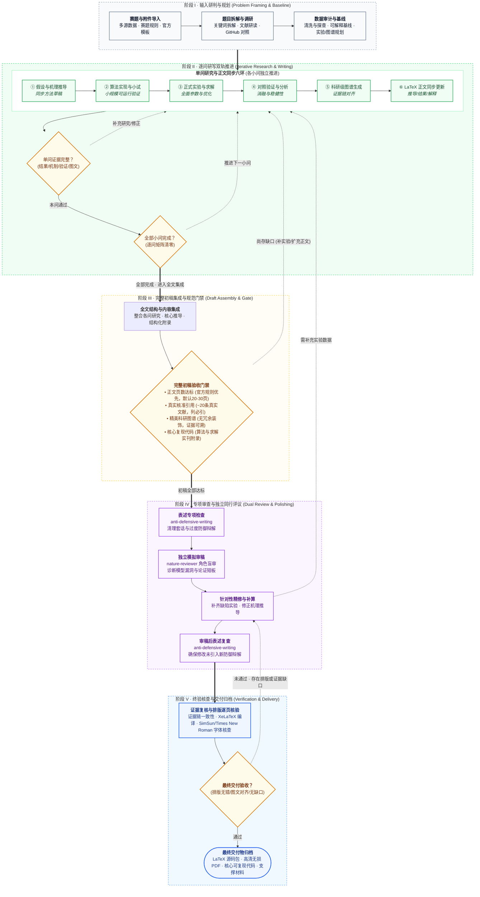

# 数学建模工作台

v0.1.0 · 通用流程预览版 · Windows / Python 3.12+ / XeLaTeX

首次使用：下载本仓库 → 运行setup.ps1 → 配置运行端技能与字体 → 在助手中打开项目 → 提供新题资料路径。完整操作见[启动指引](USER_GUIDE.md)，依赖见[部署说明](DEPLOYMENT.md)。

本项目提供规则、模板和检查工具，需要具备本地读写、代码执行及联网检索能力的AI助手参与。安装脚本不自动完成研究，也不自动安装模型服务、TeX、商业字体或技能。

长期工作采用多案例结构。根目录提供规则、模板和工具，每道新题在 `cases/<案例名>/` 中独立完成。切换活动案例时可以保留其他题的研究记录。

Windows 电脑取得项目后，在项目根目录运行 `powershell -NoProfile -ExecutionPolicy Bypass -File .\setup.ps1`，即可创建 Python 环境、安装工作台依赖并运行工具检查。需要预先安装 Python 3.12 或更新版本。论文编译另需 XeLaTeX 和规定字体，审稿与绘图等技能由运行端安装。具体范围见[部署说明](DEPLOYMENT.md)。

使用入口：[操作指南：从新题导入到论文交付](USER_GUIDE.md)。通常提供资料路径并发送启动指令即可，无需自己运行命令。

工作台支持长期保留多个独立案例。活动案例由workspace.json指定，当前研究进度以该案例的STATUS.md为准；此前清理记录属于历史，不代表当前仍待导入。

先读AGENTS.md、README.md、STATUS.md和WORKFLOW.md，再根据workspace.json读取活动案例的competition.md及STATUS.md。根competition.md是待导入模板，不覆盖活动案例配置。

## 工作流总览



实验记录、结果登记与论文证据表贯穿研究和修改。完整初稿验收同时检查逐问论证、正文页数、整套图谱、引用、字体及实质性附录；缺项时继续补足。关键文献无法获取时会向你索取，其余工作继续推进。详细步骤与验收以 [WORKFLOW.md](WORKFLOW.md) 为准。

## 新题启动

1. 提供新赛题及附件的本机文件夹路径。助手将为新题创建独立案例，并把资料复制到案例内的 `00_inputs/`。
2. 发送“启动这道题的数学建模工作流”。能够从材料核实的信息自行处理，仅方向性缺失信息提问。
3. 先核比赛/题号/规则和全部资料，再逐问拆解、数据审计、近期文献与GitHub调研，形成基线及实验计划。
4. 每问同步完成推导、求解、结果、解释、验证和图表，更新LaTeX正文与证据。

主线：研究与写作同步 → 完整初稿验收 → 防御性表述专项检查 → nature-reviewer独立审稿/修改 → 表述复查与编译核验 → 交付。

正文默认20—30页，赛题特殊说明优先、约20条真实正文引用、丰富而不冗余的科研图、背景/重述、宋体/Times及摘要数值粗体等持续适用，具体规则见AGENTS.md。未达完整性要求统一称阶段研究稿，不把短篇基线稿称完整初稿。官方约束逐题核实。

## 目录与工具

每道题使用 `cases/<案例名>/`。案例内的00_inputs存原始资料，01_problem存拆解、调研和交接，02_models存模型，03_code存实现，04_experiments存运行，05_figures存图，06_paper存LaTeX和核验，07_delivery存交付。根目录的templates和tools提供通用模板和检查器。

当前设备运行入口为`.venv/Scripts/python.exe`，不将现有环境当作新题依赖已锁定。使用方法见tools/README.md。

```powershell
& '.venv/Scripts/python.exe' tools/workbench.py context
& '.venv/Scripts/python.exe' tools/workbench.py paper-style
```

尚未导入赛题时没有main.tex、研究结论或最终论文；论文相关检查应报告缺少输入，不能以空壳文件制造通过。
